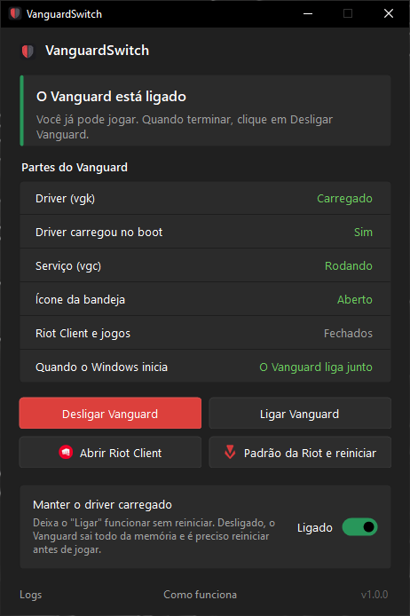

<p align="center">
  
</p>

<h1 align="center">VanguardSwitch</h1>

<p align="center">
  Turn Riot Vanguard off when you're not playing, and back on without rebooting.
  <br>
  For PCs that can't use Riot's own On-Demand mode.
  <br>
  <a href="#português">Português</a>
</p>

<p align="center">
  <a href="../../releases/latest"></a>
  
  
</p>

<p align="center">
  
</p>

Riot Vanguard keeps a kernel driver (`vgk`) and a service (`vgc`) running all the time, even when you're
not playing. Windows lets you turn them off, but turning Vanguard back on normally needs a reboot.

VanguardSwitch closes Riot and Vanguard with one click and keeps only the driver loaded, so turning it back
on takes a second instead of a reboot.

## What about Vanguard On-Demand?

On June 24, 2026 Riot added an official **On-Demand mode** to Vanguard. With it, Vanguard starts when you
open a Riot game and shuts down after you finish. It's only offered on PCs that pass **Vanguard Pre-Check**,
which requires all of these:

| Requirement | Notes |
| --- | --- |
| Windows 11 25H2 or newer | Windows 10 isn't supported at all |
| UEFI with Secure Boot on | Legacy BIOS/CSM boot doesn't qualify |
| TPM 2.0 | Firmware TPM (fTPM/PTT) is fine |
| IOMMU | AMD-Vi / Intel VT-d enabled in the BIOS |
| Virtualization-Based Security (VBS) | |
| Hypervisor-Protected Code Integrity (HVCI) | "Memory integrity" in Windows Security |

Riot says about 35% of players already meet them. The Vanguard tray icon shows which ones are missing,
and Riot says more checks may be added later.

**If your PC qualifies, use Riot's On-Demand mode.** It's official and needs nothing else.

VanguardSwitch is for everyone else: Windows 10, older hardware, or people who don't want to turn on
VBS/HVCI (they cost some performance on older CPUs). It gives you the same idea, Vanguard off while you're
not playing, using only the switches Windows already has.

Sources: [Riot's announcement](https://www.riotgames.com/en/news/vanguard-on-demand),
[Vanguard Pre-Check on Riot Support](https://support.riotgames.com/en-us/riot/performance/vanguard-pre-check).

## Download

Grab `VanguardSwitch.exe` from [Releases](../../releases/latest). No install. It asks for admin rights
because only an admin can stop services. Every release is built from this repo by
[GitHub Actions](.github/workflows/build.yml) and lists the file's SHA-256.

Windows SmartScreen may warn the first time because the file isn't code-signed. Click
**More info → Run anyway**.

## Usage

- **Turn off**: closes Riot Client, VALORANT, League of Legends, LoR, 2XKO and the tray icon, then stops
  `vgc` and blocks it so Riot Client can't start it again.
- **Turn on**: starts `vgc` and the tray icon again and sets Vanguard to start with Windows.
- **Keep the driver loaded** (on by default): `vgk` stays in memory when you turn off. Uncheck it to unload
  everything; you'll need one reboot before playing again.
- **Riot default and restart**: puts everything back the way Riot installs it and reboots.

The window shows what each part is doing, warns if something else turns Vanguard back on, and checks every
step after you click. Text is in English or Portuguese, following your Windows language.

### Error VAN 57

In Vanguard's traditional mode (without On-Demand), starting `vgk` after Windows booted can cause VAN 57.
Reboot once and keep *Keep the driver loaded* checked from then on.

The *Driver loaded at boot* row tries to warn you before you open the game. It compares the time of
Vanguard's own driver log (`Logs\vgk_*.log`) with the time Windows started, and also remembers when the
app itself started or stopped the driver. It's an estimate, not Riot's own check: a changed system clock,
missing logs or a new log format from Riot can fool it (it then shows *Unknown*), and it only catches this
one cause of VAN 57, not all of them.

## Updates

When it opens, the app asks GitHub for the latest release. If there's a newer one, it shows
**Update** or **Close**. Update downloads the new `VanguardSwitch.exe` and its `.sha256` from the release,
refuses to install if the checksum is missing or doesn't match, replaces the old file and reopens.

The checksum only proves the file is the one published in the release; the exe isn't code-signed.
Network access is limited to GitHub's API and GitHub-hosted release downloads.

## How it works

| | Turn off | Turn off (driver unloaded) | Turn on |
| --- | --- | --- | --- |
| `vgk` kernel driver | stays loaded | unloaded, blocked | loads at boot |
| `vgc` service | stopped, blocked | stopped, blocked | automatic, running |
| `vgtray` tray icon | closed, off at startup | closed, off at startup | running, on at startup |
| Riot Client and games | closed | closed | |

"Blocked" is the `disabled` start type. With `manual`, Riot Client can start Vanguard by itself.
Startup entries are changed the same way Task Manager does it. No Vanguard file is changed.

## Build

```sh
dotnet build src/VanguardSwitch.csproj -c Release
```

Works on Windows or Linux with the .NET 8 SDK. The app targets .NET Framework 4.8, which ships with Windows 10 and 11.

## Disclaimer

Not affiliated with Riot Games. Riot Vanguard, VALORANT and League of Legends are trademarks of
Riot Games, Inc. Use at your own risk.

---

## Português

Desliga o Riot Vanguard quando você não está jogando e liga de novo sem reiniciar o PC.

### E o Vanguard On-Demand?

Em 24 de junho de 2026 a Riot lançou o **modo On-Demand** do Vanguard: ele liga quando você abre um jogo
da Riot e desliga quando você termina. Só que ele só aparece em PCs que passam no **Vanguard Pre-Check**,
que exige tudo isto:

- Windows 11 25H2 ou mais novo (Windows 10 não entra);
- UEFI com Secure Boot ligado;
- TPM 2.0 (o TPM do processador, fTPM/PTT, serve);
- IOMMU (AMD-Vi / Intel VT-d ligado na BIOS);
- VBS (segurança baseada em virtualização);
- HVCI ("Integridade de memória" na Segurança do Windows).

Segundo a Riot, uns 35% dos jogadores já atendem. O ícone do Vanguard na bandeja mostra o que falta.
**Se o seu PC atende, use o modo da Riot**, que é oficial.

O VanguardSwitch é pra quem não atende (Windows 10, PC mais antigo, ou quem não quer ligar VBS/HVCI) e
quer deixar os serviços da Riot desligados enquanto não está jogando.

### Uso

Baixe o `VanguardSwitch.exe` em [Releases](../../releases/latest). Não precisa instalar. Se o
SmartScreen avisar, clique em **Mais informações → Executar assim mesmo**.

- **Desligar**: fecha o Riot Client, os jogos e o ícone da bandeja, para o serviço `vgc` e bloqueia para
  ele não voltar sozinho.
- **Ligar**: liga o serviço e o ícone de novo e deixa o Vanguard ligando com o Windows.
- **Manter o driver carregado** (já vem marcado): o driver `vgk` continua na memória, e é por isso que o
  "Ligar" funciona sem reiniciar.

**Erro VAN 57:** no modo tradicional do Vanguard (sem On-Demand), ligar o driver depois do boot pode causar
esse erro. Reinicie o PC uma vez e deixe a opção marcada.
A linha *Driver carregou no boot* tenta avisar isso antes de abrir o jogo, comparando o horário do log do
driver com o horário em que o Windows ligou. É uma estimativa, não a checagem da Riot: relógio alterado,
log faltando ou mudança no formato dos logs podem enganar (aí aparece *Não dá para saber*), e ela só pega
essa causa do VAN 57, não todas.

**Atualizações:** ao abrir, o app confere no GitHub se saiu versão nova e mostra **Atualizar** ou
**Fechar**. Atualizar baixa o exe e o `.sha256` da release, recusa instalar se o hash faltar ou não bater,
troca o arquivo e abre de novo. O app só acessa a rede pela API do GitHub e pelos downloads das releases.

O programa não altera nenhum arquivo do Vanguard. Sem vínculo com a Riot Games.
